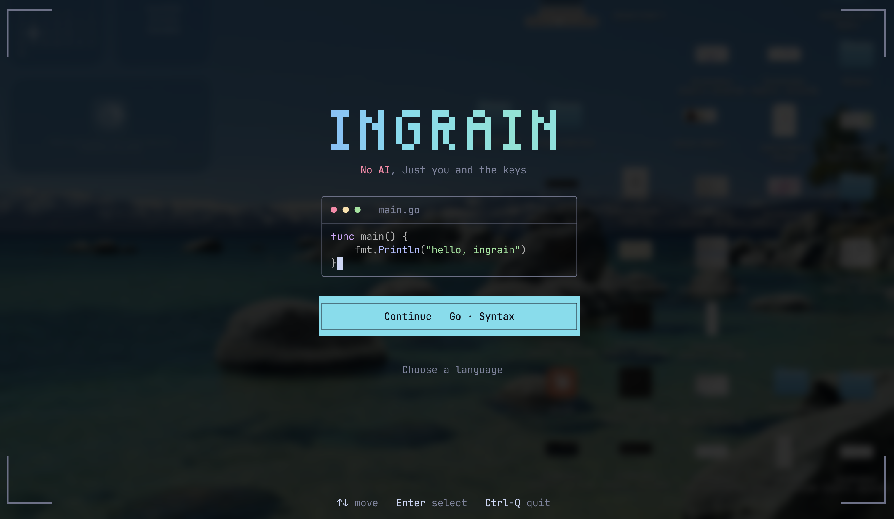
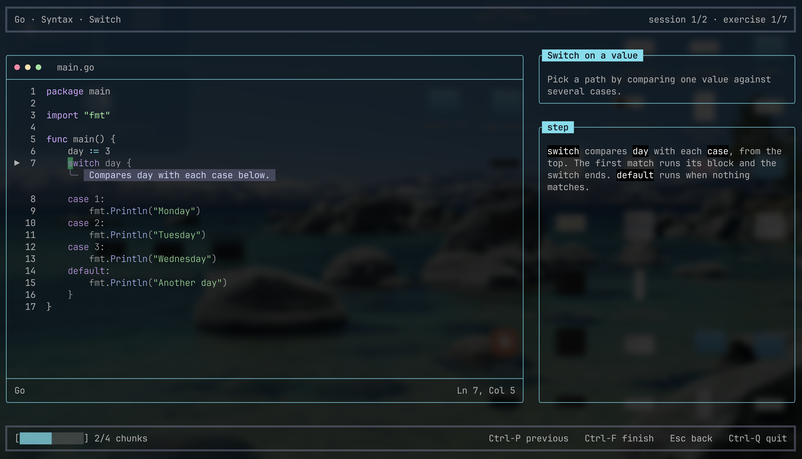
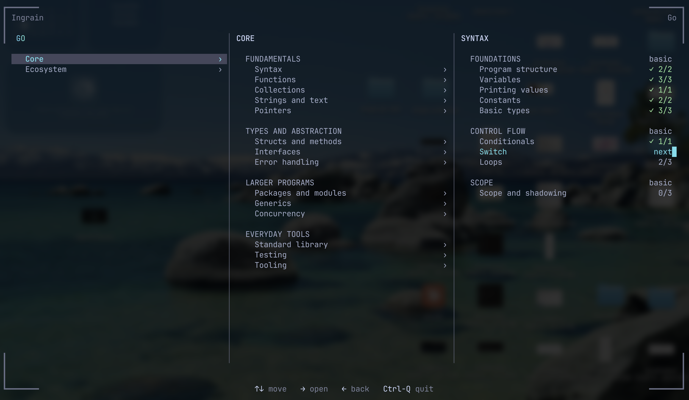
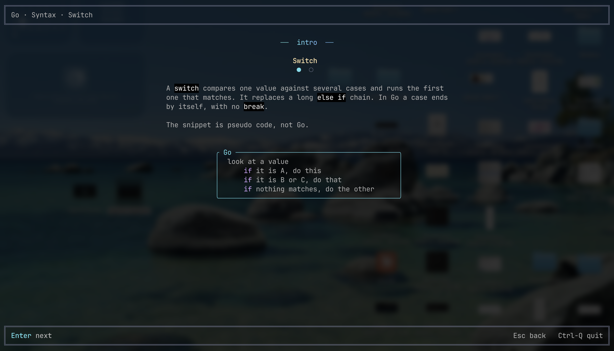
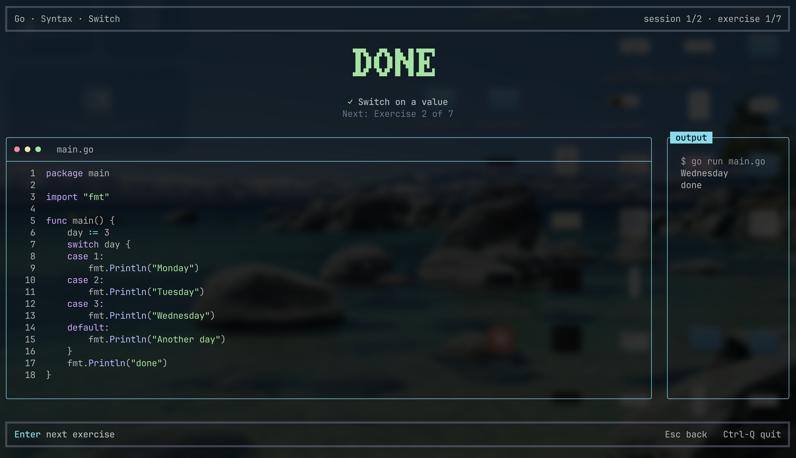

<h1 align="center">Ingrain</h1>

<p align="center">
  <b>Learn a programming language by typing it. Keep it by never stopping.</b><br>
  <sub>Rust and Go, in your terminal. No autocomplete. No copy-paste. No AI.</sub>
</p>

<p align="center">
  
</p>

## 🎬 Demo

<!-- 🎞️ DEMO: the typing GIF → docs/assets/typing-demo.gif -->
<!--  -->

## 🧠 Why Ingrain

Agents write the code now. Engineers ship things they could not write alone, and the syntax, the idioms and the debugging instincts fade.

Ingrain is the gym for that muscle. It builds it with the oldest method there is: **typing the code by hand until it sticks.**

## ✨ Features

- **⌨️ Ghost typing.** The code appears faded and you type over it, with a short note under each piece saying what it does and why. Your fingers learn the language, not only your eyes.
- **🎯 Made for people who already code.** No lessons on what a variable or a loop is. Every module teaches what the language does *differently*: the rules, the traps and the idioms.
- **🧩 Three ways to practice.** Typing, quizzes and fill-in-the-blank, mixed in short Duolingo-style sessions.
- **🗺️ Real structure.** Courses, modules and sessions, from the first concept to the hardest, each opening with a short explanation.
- **🚀 Pick up where you left off.** Progress is saved, failed exercises come back for a retake, and Continue drops you in the exact exercise you stopped at.
- **📦 One binary, fully offline.** All the content ships inside it. No account, no server, no AI at runtime.
- **🎨 A terminal you will enjoy.** Syntax highlighting, animations and a full-screen explorer.

## ⌨️ Type it, don't read it

Every exercise is typed by hand. Ghost text shows the way and a note explains each piece.

<p align="center">
  
</p>

Tired? `Ctrl-F` finishes the chunk for you, but the app reminds you that the typing is the point.

<!-- 📸 SCREENSHOT: the finish modal after repeated Ctrl-F → docs/assets/finish-modal.png -->
<!--  -->

## 🧩 Quizzes and fill-in-the-blank

Short checks between the typing, on the rules and traps that bite programmers coming from another language.

<!-- 📸 SCREENSHOT: a quiz exercise → docs/assets/quiz.png -->
<!--  -->

<!-- 📸 SCREENSHOT: a fill-in-the-blank exercise → docs/assets/fill-blank.png -->
<!--  -->

## 🗺️ Courses, modules, sessions

Browse the whole map in a Miller-columns explorer: language, layer, course, module. Each module opens with a short intro before the first exercise.

<p align="center">
  
</p>

<p align="center">
  
</p>

## 🏆 Finish what you start

Every exercise, session and module ends with a recap. If you fail one, you retake only what you missed. Progress is saved, so tomorrow starts where today ended.

<p align="center">
  
</p>

## 📚 What you can learn

| | Core | Ecosystem |
|---|---|---|
| **Rust** | syntax, ownership, borrowing, lifetimes, traits, generics, iterators, closures, async, unsafe, macros... | tokio, serde, rayon, reqwest, regex, tracing, anyhow, thiserror... |
| **Go** | syntax, pointers, interfaces, error handling, generics, concurrency, testing, tooling... | cobra, viper, gin, gorm... |

**1,200+ exercises** and counting. The basics are free, the harder tiers are the paid ones.

## 🏃 Quick start

You need [Rust](https://rustup.rs).

```bash
git clone https://github.com/austinbrage/ingrain.git
cd ingrain
cargo run --release
```

| Key | Does |
|---|---|
| `↑` `↓` | move |
| `→` `←` | open and go back in the explorer |
| `Enter` | select, start or continue |
| `Ctrl-F` | finish the current chunk |
| `Ctrl-P` | go back a chunk |
| `Esc` | go back |
| `Ctrl-Q` | quit |

## 🛠️ Under the hood

Built with [ratatui](https://ratatui.rs). The content is plain JSON, kept apart from the screens, so the same courses can power a web version.

```
src/
  app/        state and key events
  content/    JSON parsing
  ui/         screen drawing
  progress/   what the user has done
content/      the courses, embedded in the binary
docs/         structure, UI sketches, glossary
```

`ui` reads `app`, and `app` reads `content`.

```bash
cargo test    # end-to-end tests: drive the app with keys and read the screen
```

To see what a test sees, add `println!("{}", screen.text());` to it and run `cargo test <test_name> -- --nocapture`.
